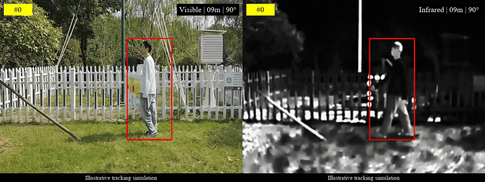

# Dual-Modal Camouflage Generation and Optimization

A research codebase for generating paired visible and infrared background patches and optimizing them against a visual tracker through bounding-box queries.

The pipeline combines masked foreground preprocessing, prototype-conditioned diffusion generation, perspective-aware patch placement, and black-box optimization. Visible and infrared patches share scene geometry while retaining modality-specific appearance.

## Pipeline

1. **Prepare foreground data.** Use bounding-box labels and binary masks to crop targets, remove the background, and resize foregrounds.
2. **Build prototypes.** Select keyframes independently for each modality, extract frozen VAE descriptors, cluster them, and align the two prototype sets using paired training frames.
3. **Train the generator.** Construct shared and modality-specific conditions and train a paired conditional DiT with image supervision and an optional worst-prototype distance objective.
4. **Generate initial patches.** Sample visible and infrared images from a trained conditional checkpoint using shared initial noise.
5. **Optimize against the tracker.** Apply the patches to paired sequences, query ViPT bounding boxes, and update patch pixels with a normalized stochastic finite-difference estimator.

```text
Images + labels + masks
        |
        v
Masked foregrounds -> keyframes -> VAE descriptors -> prototypes C
        |                                                 |
        |                              h = LN(WC) -> fusion c -> q = [c, C]
        |                                                 |
        +--------------> conditional DiT training <-------+
                                  |
                                  v
                       visible.png + infrared.png
                                  |
                                  v
                 distance/viewpoint-aware patch placement
                                  |
                                  v
                  ViPT box queries -> black-box optimization
                                  |
                                  v
                        optimized paired patches
```

## Repository layout

```text
.
├── configs/         Dataset paths and stage-specific parameters
├── datasets/        Dataset, cache, and sequence-split placeholders
├── preprocessing/   Annotation generation and paired patch placement
├── generator/       Prototype construction, conditional DiT, and sampling
├── optimization/    Black-box optimizers and evaluation utilities
├── tracker/         ViPT model and tracking framework
├── weights/         Model checkpoint placeholders
├── outputs/         Generated artifacts and experiment outputs
├── scripts/         Pipeline command preview
└── docs/            Data format, method, and configuration documentation
```

See [PROJECT_STRUCTURE.txt](PROJECT_STRUCTURE.txt) for the file tree.

## Data and checkpoints

Configure dataset and checkpoint locations in [configs/paths.json](configs/paths.json). Paths are relative to the repository root. Generator training and tracker optimization can reference the same paired dataset or separate datasets with the same format.

- Generator training sequences: `datasets/generator_train/dataset_400_2/`
- Prepared foreground and latent cache: `datasets/generator_train/prepared/`
- CARLA optimization sequences: `datasets/carla/dataset_400_2/`
- Sequence splits: `datasets/splits/`
- Model checkpoints: `weights/`

Datasets, checkpoints, and generated results are not included. See [data format](docs/data.md) and [checkpoint layout](weights/README.md).

## Workflow

The command preview reads the JSON configuration files and prints commands for each stage:

```bash
python scripts/pipeline.py all
```

Individual stages are `annotate`, `prepare`, `train-base`, `train-prototype`, `generate`, `optimize`, and `optimize-pixel`. The preview does not execute these stages.

The implementation requires a compatible PyTorch/torchvision installation, the dependencies in `requirements.txt`, prepared data, and matching model checkpoints. A ViPT checkpoint must be paired with its corresponding architecture configuration. The included `deep_rgbt.yaml` defines a model configuration; it does not establish compatibility with arbitrary checkpoints.

## Main interfaces

| Component | Entry point |
| --- | --- |
| Fixed-camera annotations | `preprocessing/build_fixed_camera_annotations.py` |
| Foreground, keyframes, and prototypes | `generator/paired_dit_data.py` |
| Prototype-conditioned DiT | `generator/paired_dit_model.py` |
| Generator training | `generator/train_paired_dit.py` |
| Paired patch generation | `generator/sample_paired_dit.py::generate_paired_patches` |
| Fixed-camera placement | `preprocessing/apply_paired_patches.py::apply_static_paired_patches` |
| Color-coherent optimization | `optimization/optimize_dataset4002_coherent.py` |
| Pixel-wise optimization | `optimization/optimize_dataset4002_blackbox.py` |

## Documentation

- [Dataset format and splits](docs/data.md)
- [Generator architecture and training](docs/generator.md)
- [Placement and black-box optimization](docs/optimization.md)
- [Configuration reference](docs/configuration.md)
- [Third-party components](THIRD_PARTY_NOTICES.md)

Generator outputs are conditioned image samples. Attack effectiveness is measured in the subsequent tracker evaluation and is not implied by the generator objective alone. This repository provides the source implementation and configuration templates; complete training and evaluation require the external data and model artifacts described above.

## Demonstration


